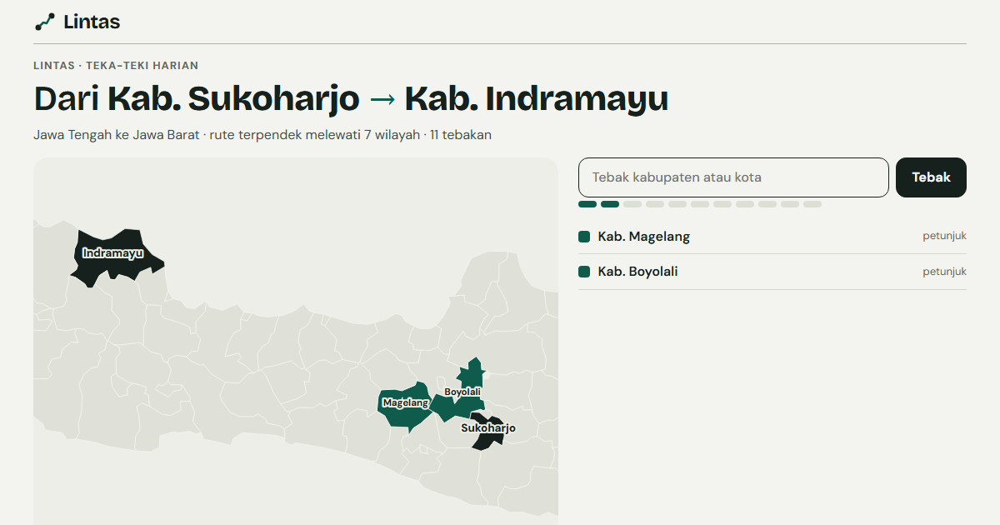

# Lintas



**[Main Lintas](https://lintas.raffstw.my.id)**

Teka-teki geografi harian untuk 514 kabupaten/kota Indonesia, terinspirasi Travle. Setiap
hari ada dua kabupaten/kota di satu pulau; tebak wilayah di antara keduanya sampai jalurnya
tersambung lewat perbatasan darat.

- Jumlah tebakan: wilayah di rute terpendek ditambah empat. Tebakan boleh tidak berurutan.
- Setiap tebakan dinilai menurut seberapa jauh ia menyimpang dari rute terpendek: di rute,
  dekat (1–2 langkah memutar), agak jauh (3–4), atau jauh. Warnanya skala satu rona, jadi
  tetap terbaca untuk buta warna, dan selalu disertai label.
- Petunjuk membuka satu wilayah di rute dengan memakai satu tebakan.
- Teka-teki baru setiap pukul 00.00 WIB, sama untuk semua orang; hasil bisa disalin sebagai
  kotak emoji. Mode latihan memberi teka-teki acak tanpa batas.
- Permainan dan statistik (dimainkan, menang, beruntun) tersimpan di peramban.

## Cara kerja

Graf ketetanggaan dibangun langsung dari topologi peta batas kabupaten/kota
(`topojson.neighbors`): dua wilayah bertetangga bila berbagi garis batas. Rute terpendek
dihitung dengan BFS dari kedua ujung; penyimpangan sebuah wilayah adalah
`jarak(awal, x) + jarak(x, akhir) − jarak(awal, akhir)`. Teka-teki harian dibuat dari benih
nomor hari (mulberry32), dengan rute 4–8 langkah di daratan yang cukup besar.

Peta: geoBoundaries ADM2 (BPS, WFP, OCHA ROAP; CC BY 3.0 IGO), disederhanakan, sehingga
batas laut dan jembatan tidak dihitung dan wilayah yang hanya bersentuhan di satu titik
mungkin tidak terhitung bertetangga.

## Menjalankan

```
npm install
npm run dev
npm test        # ketetanggaan, rute, penilaian, teka-teki harian (vitest)
npm run build
```

Vite + TypeScript, tanpa framework UI; d3-geo dan topojson-client.
